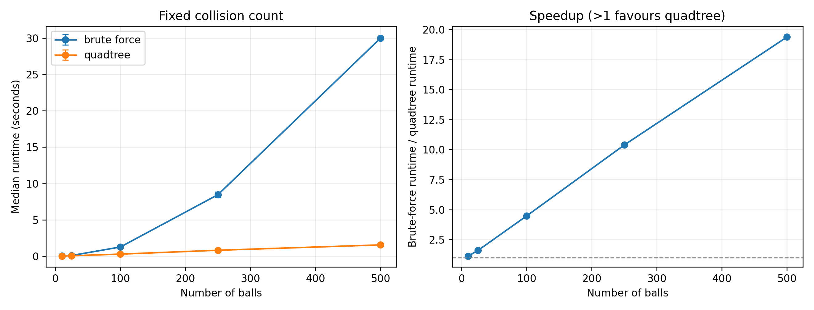

# Collision-search benchmarks

Run from the repository root with NumPy and Matplotlib installed. The `src`
directory must be on Python's import path:

```bash
PYTHONPATH=src python3 optimisations/benchmark.py --balls 37 100 250 --collisions 100 --repeats 3 --csv /tmp/thermosnooker-timings.csv --plot /tmp/thermosnooker-timings.png
```

For a quick first check, use `--balls 7 37 --collisions 10 --repeats 1`.
Increase `--balls` to explore larger systems; brute force becomes expensive.
Use the same `--seed` to reproduce initial conditions. The script opens no GUI
windows; `--plot` saves a figure. Both output paths are optional.

The table reports median wall-clock seconds over the repeats. Speedup is
`brute_force_seconds / quadtree_seconds`: values above one favour the quadtree.
The CSV retains every individual run, its seed, and the simulated physical time.
The plot shows medians with the minimum-to-maximum repeat range and a speedup
panel.

## What is timed

Each sample times `simulation.run(m, animate=False)` with
`time.perf_counter()`. Object construction, imports, a short warm-up,
correctness checks, and writing outputs are excluded. All work during the run is
included: collision searching, rebuilding the quadtree, moving balls, updating
the container, and recording measurements. This measures the complete simulation
loop, rather than only the tree query.

Each method starts from the same positions and seeded random velocities for a
given repeat. Method order alternates between repeats. After each pair of runs,
the script checks positions, velocities, elapsed simulation time, and wall impulse
agree within numerical tolerances, outside the timed region. A disagreement
raises an error rather than reporting a potentially incorrect speedup.

The collision count stays fixed while particle count changes. Balls have radius
0.5, speed 10, and start on rings spaced three units apart. The container grows
with the number of rings, keeping density approximately constant and avoiding
initial overlaps. Arbitrary particle counts partially fill the outermost ring,
so density varies slightly between cases. Complete rings occur at 7, 19, 37,
61, 91, 127, 169, 217, 271, ... particles.

## Selecting a search method directly

```python
from thermosnooker.simulations import MultiBallSimulation

simulation = MultiBallSimulation(collision_search="quadtree", seed=12345)
elapsed = simulation.run(100, output_time_taken=True)
print(f"Simulation took {elapsed:.6f} seconds")
```

`collision_search="brute_force"` retains the all-pairs reference implementation
and remains the default. `run()` returns elapsed seconds when
`output_time_taken=True`; otherwise it retains its existing return behaviour.
For arbitrary particle counts, supply `num_balls` and enough ring capacity, as
`simulation_parameters()` in the benchmark does.

## Interpreting the scaling

Brute force checks every pair on each event, giving an O(N²) pair search. A
quadtree can reduce the candidate set, but does not guarantee O(N log N) for an
entire event-driven search: dense clusters, overlapping swept bounds, and long
time horizons can still lead to O(N²) candidate checks. Python tree-building and
query overhead can also make it slower for small systems.

The tree must account for motion. Checking only current spatial neighbours can
miss the earliest collision between balls that are currently far apart. This
implementation conservatively bounds motion up to the current earliest known
event, prunes regions that cannot meet a ball in that interval, then uses the
same exact collision-time calculation as brute force for the remaining pairs.
The tree is rebuilt each event because positions and velocities change.

Compare multiple particle counts and repeats on the same machine before drawing
conclusions about a speedup or asymptotic scaling.


